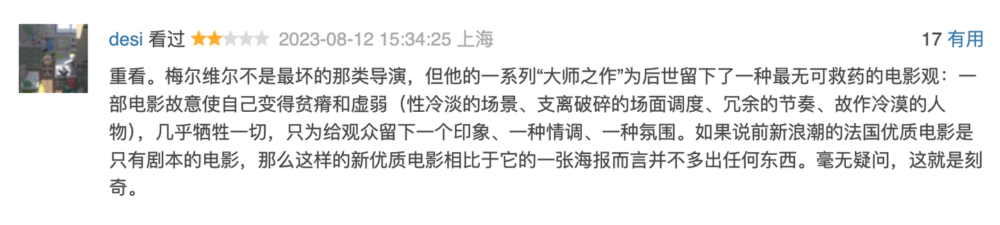

My way into Jean-Pierre Melville, in order, was [*Army of Shadows*](https://movie.douban.com/subject/1466419/), [*Le Cercle Rouge*](https://movie.douban.com/subject/1401915/), [*Le Samouraï*](https://movie.douban.com/subject/1300966/), [*Bob le flambeur*](https://movie.douban.com/subject/1299521/), [*Le Silence de la mer*](https://movie.douban.com/subject/1466403/), [*Un flic*](https://movie.douban.com/subject/1301658/), [*Le Doulos*](https://movie.douban.com/subject/1466414/), and [*Le Deuxième Souffle*](https://movie.douban.com/subject/1438068/).

Melville belonged to none of the three French traditions that fed his work: the New Wave, the “Tradition of Quality,” and poetic realism. He inherited all three. What he did to them was a kind of distillation.

One way to understand Melville is to watch *Le Cercle Rouge*, the film that brings his late work together, alongside another French heist picture, *Rififi* (*Du rififi chez les hommes*, 1955).

At the heart of each film is a jewelry store robbery that takes close to half an hour and unfolds almost entirely without dialogue. What interests me about the pairing is how far French crime cinema traveled in the fifteen years between them. In Dassin’s postwar noir, you can still feel the texture of life at the bottom of the ladder, the weight of bodies, the life of the city. By the time we reach Melville, the men inhabit a closed, abstract world governed by ritual.

Jules Dassin, an American director driven into exile by the Hollywood blacklist, shot *Rififi* in Paris. Criterion describes the film as a blend of American genre craftsmanship, French cool, and the naturalism of the streets. Melville himself had been in line to direct it before Dassin took it on. Fifteen years later, Melville made *Le Cercle Rouge*. He described it as a Western transposed to contemporary Paris, and as a summation of all the crime thrillers he had made up to that point.

## The social roots of crime in *Rififi*

*Rififi* is a postwar noir variation on poetic realism. The fatalism, marginal urban spaces, and defeated men of the older French films meet the rhythms of American noir and the particular demands of staging a heist. The BFI makes a similar observation about postwar French noir more broadly, tracing its fatalism to prewar social realism and its formal vocabulary to American hard-boiled cinema.

- Cinematographer Philippe Agostini had worked on Marcel Carné’s *Le Jour se lève*. Art director Alexandre Trauner was a key member of the Carné–Prévert circle, with credits on *Port of Shadows*, *Hôtel du Nord*, *Le Jour se lève*, and *Children of Paradise*. You can see that history in the lighting of *Rififi*, in its streets and interiors, even in the faces. The film retains a visual memory of French poetic realism in the 1930s.
- Jean Servais’s face matters especially. In *Une si jolie petite plage*, he played Fred, the man who comes looking for the protagonist. By *Rififi*, he is an aging criminal marked by prison, illness, and failure. Criterion gets his appearance exactly right when it likens him to a Jean Gabin drained of life, already cold as a corpse.
- Alain Delon has the kind of cold, sculpted beauty that can stand free of any social background and become an image in its own right. Gabin, in the days of poetic realism, carried the weight of the working-class hero, the masculine ideal, and the tragic lover. Servais looks more worn and a little cheaper. His is the face of a man who has actually lost. You can read the years in prison there, along with poverty, bad lungs, age, and violence.

For all the precision of its heist, *Rififi* stays in touch with the world its thieves live in. There are wives, children, lovers, nightclubs, memories of prison, and a pecking order in the underworld. These men have families and bodies and appetites. Money troubles and the people they love can break them.

## The sound of work and the silence of ritual

The famous jewelry store sequence in *Rififi* runs for close to half an hour without dialogue or a conventional score. We hear the drill, the tools, plaster breaking, soft footsteps, an alarm quickly silenced. The four men are working. They study the building, work out the timing, open a hole, haul things, take turns. By the end there is a peculiar sense that they have *earned* the jewels, with their heads and their hands.

The robbery in *Le Cercle Rouge* is just as long, quiet, and exact. Here it takes on the character of a religious rite. The men put on leather masks and enter a Paris emptied out for the night. Guns, keys, glass, detectors, and staircases fall into a cold geometry. When Jansen sets his scope aside and makes the shot by eye, the moment has the force of a small miracle. What is at stake is his pride in his craft. The question of how plausible the shot might be hardly enters into it.

Dassin’s four thieves make up a temporary construction crew. Melville’s three are priests at the altar.

You can see the change in the casting, too. Alain Delon’s Corey scarcely has a past. A trench coat, a hat, a silence, a glance, a sequence of practiced movements take the place of the class, way of life, or social experience we might otherwise read in him. Gian Maria Volonté makes an interesting exception. If you have seen him in the Italian political cinema of Elio Petri and his contemporaries, in *The Working Class Goes to Heaven*, *Uomini contro*, or *Investigation of a Citizen Above Suspicion*, the violence and radical politics of those years enter the frame with him. Volonté was so closely identified with politically engaged Italian cinema that it is easy to imagine his Vogel as a terrorist or a political fugitive. Melville deliberately plays those associations down. What remains is an energy all the more violent for being hard to place.

## What goes wrong after a successful robbery

In *Rififi*, what destroys the gang still comes out of its social life. Someone shows off, someone desires someone else, word gets out. There are rival gangs to reckon with and children to protect. Dassin makes informing the one unforgivable sin of the underworld. Yet the very possibility of informing comes from the fact that the thieves can never quite withdraw from society. They want to celebrate, give presents, see their lovers, protect their families. Eventually the jewels, too, have to go back into circulation. Once they start passing from hand to hand, the perfect operation begins to come apart.

In *Le Deuxième Souffle*, the platinum robbery goes to plan. What undoes Gu is his reuse of a gun, a police trick involving a recording, and his own impulse to defend his companions’ good name. In *Le Cercle Rouge*, the thieves get the jewels out intact. It is the sale that Mattei takes over. The police put pressure on Santi, pose as buyers, and spring their trap. In *Un flic*, the train robbery is again filmed as an almost abstract passage of silent action. The recurring question in late Melville is what happens once the plan has worked.

> You can pull off the job. You can’t withdraw from the world you have to live in afterward.

The police in Melville have no particular advantage in intelligence, courage, or justice. What the institution gives them is time. They can wait, watch, assume other identities, put pressure on a go-between. Long after the crime, they can piece the whole network of relationships back together. The thieves get twenty minutes in which to achieve perfection. The state can keep the investigation going indefinitely.

## Two short reviews by [desi](https://www.douban.com/people/172966091/)

Both reviews are translated from Chinese.

**On *Le Samouraï* · 2/5 stars**

> On a rewatch. Melville may not be the worst kind of director, but the idea of cinema his string of “masterpieces” has bequeathed to us seems beyond saving. A film deliberately makes itself poor and feeble (sexless scenes, fragmented staging, slack pacing, characters affecting indifference). Almost everything is sacrificed to leave the viewer with an impression, a mood, an atmosphere. If the French Tradition of Quality before the New Wave gave us films that amounted to little more than their screenplays, this new cinema of quality has scarcely more to offer than one of its own posters. This is kitsch, surely.

<figure>
  
  <figcaption>desi on <i>Le Samouraï</i>, in the original Chinese.</figcaption>
</figure>

**On *Le Cercle Rouge* · 1/5 stars**

> Male chauvinism takes two forms here: glorifying fate and “making crime look elegant” (could anything be further from the point of *Pickpocket*?). In Melville’s films you can be unmoved by a character’s death because it is only one more link in the chain of fate, one more step in the pursuit of elegance. The two amount to the same thing.

<figure>
  
  <figcaption>desi on <i>Le Cercle Rouge</i>, in the original Chinese.</figcaption>
</figure>

Melville did steadily empty French crime cinema of much of its social content. Women, more present even in his own early work, gradually disappear. Class backgrounds fade, psychology contracts, rooms and objects become fetishes. Trench coats, hats, guns, cars, rooms, even silences acquire a dignity that exceeds that of the people in the frame. *Le Samouraï* pares away almost all sex, feeling, realism, and hard-boiled talk. What remains is a cold existential dream in blue-gray.

Whatever nobility Melville’s men possess comes from their effort to live by a private code that has outlived its time, in a world where every institution and every tie will betray them. The code gives them their dignity and makes their deaths inevitable. Glorifying fate and making crime look elegant may indeed be two sides of the same coin. But Melville has at least an inkling of what such elegance is: a tomb.

## What distillation costs

Melville was an important precursor to the New Wave. He produced his films independently, built his own studio, and took *Bob le flambeur* out into the streets. He also retained the technical control and narrative discipline of the classical French studio system, qualities associated with the Tradition of Quality. From poetic realism, by way of French noir, he inherited the rainy nights, the defeated men, the sense of fate and death.

The result is a crime cinema that scarcely belongs to any particular society. What remains are roads, rooms, guns, rules, betrayal, and death. In achieving that extraordinary formal purity, it loses the rough, dirty, lived-in social world of *Rififi*. In *Le Cercle Rouge*, French crime cinema has been refined almost to perfection. What we call purity is often what is left when the impurities of actual life have been removed, one by one: women, class, family, desire, chance.
