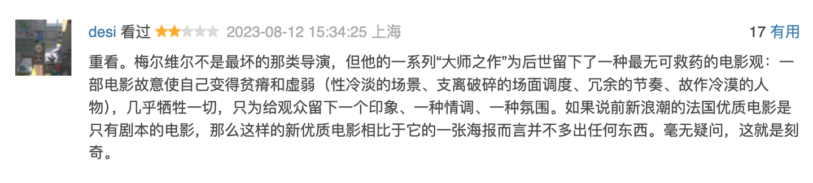

个人的入坑作顺序：[影子部队](https://movie.douban.com/subject/1466419/)、[红圈](https://movie.douban.com/subject/1401915/)、[独行杀手](https://movie.douban.com/subject/1300966/)、[赌徒鲍伯](https://movie.douban.com/subject/1299521/)、[海的沉默](https://movie.douban.com/subject/1466403/)、[大黎明](https://movie.douban.com/subject/1301658/)、[眼线](https://movie.douban.com/subject/1466414/)、[第二口气](https://movie.douban.com/subject/1438068/)。

梅尔维尔不是新浪潮，不是优质电影，也不是诗意现实主义，但又是三者的继承人。 他把传统“蒸馏”了。

理解梅尔维尔，可以把他的晚期集大成之作《红圈》与另一部法国劫案电影《男人的争斗》（Du rififi chez les hommes, 1955）并置来看。

两部影片都围绕珠宝店盗窃展开，也都以一段接近半小时、几乎没有对白的劫案场面作为核心。但它们不是简单的“同题比较”，而更像法国犯罪电影十五年间的一次形式迁移：从仍然保留社会底层肌理、身体重量与都市生活感的战后黑色电影，逐渐走向梅尔维尔那里封闭、抽象、仪式化的男性世界。

《男人的争斗》由遭好莱坞黑名单放逐的美国导演朱尔斯·达辛在巴黎拍摄；Criterion将它概括为美国类型片技艺、法国式冷感和街头自然主义的混合物。梅尔维尔原本甚至一度准备执导该片，后来才由达辛接手。十五年后，他拍出《红圈》，并亲自称其为一部“移植到现代巴黎的西部片”，也是自己此前所有犯罪惊悚片的一次汇总。

## 《男人的争斗》：犯罪仍然长在社会之中

严格说来，《男人的争斗》并不是诗意现实主义的直接延续，而是它的战后黑色变体：诗意现实主义的宿命论、都市边缘空间和失败男性，与美国黑色电影、劫案片的动作结构发生了结合。BFI也把战后法国黑色电影概括为：将战前社会现实主义的宿命感，与美国硬汉电影的形式语法熔在一起。

- 摄影师Philippe Agostini曾参与卡尔内《天色破晓》的摄影；美术指导Alexandre Trauner更是卡尔内—普雷维尔小组的关键人物，参与了《雾码头》《北方旅店》《天色破晓》《天堂的孩子》等作品。《男人的争斗》因此不是凭空出现的类型杰作，它在灯光、街道、室内空间和人物面孔上，仍然携带着1930年代法国诗意现实主义的视觉记忆。

- Jean Servais的脸尤其重要。他在《如此美丽的小沙滩》中饰演过追踪主人公而来的Fred；到了《男人的争斗》，他已经成为一个从监狱、疾病与失败中走出来的衰老罪犯。Criterion对他的形容很准确：像一个被抽干了生命力的Jean Gabin，冷得近乎尸体。

- 他没有阿兰·德龙那种经过雕刻、可以脱离社会背景而成为纯粹图像的冷美；也不像诗意现实主义时代的Gabin，身上仍然压着工人英雄、男性神话和悲剧恋人的重量。Servais的面孔更枯槁、更廉价、更接近某种真实的失败者：坐牢、贫困、肺病、衰老和暴力都已经写在脸上。

《男人的争斗》虽然拥有极其精密的劫案段落，但它没有脱离社会。犯罪者仍然生活在妻子、孩子、情人、夜总会、监狱经历和帮派等级组成的网络里。他们不是抽象的“职业罪犯”，而是一群有家庭、有肉身、有欲望，也会因贫困和关系而破裂的人。

## 同样的沉默：一边是劳动，一边是仪式

《男人的争斗》中著名的珠宝店盗窃持续近半小时，没有对白，也没有传统配乐。我们听见的是钻头、工具、碎裂的石膏、轻微的脚步和被迅速压制的警报声。四个人不是在“摆造型”，而是在劳动：观察建筑结构、测算时间、打洞、搬运、轮换位置。珠宝成为他们凭借脑力和体力“挣得”的东西。

《红圈》的珠宝店劫案同样漫长、无言、精确，但它已经不再主要表现劳动，而是在表现一种近乎宗教性的仪式。人物戴上皮革面具，进入被抽空的夜间巴黎；枪械、钥匙、玻璃、探测器和楼梯被排列成冷峻的几何形。Jansen放弃瞄准镜，凭肉眼射中警报装置的瞬间，与其说是在展示现实可信的专业技术，不如说是在完成一次关于“职业尊严”的神迹。

达辛让四名罪犯成为一支临时施工队；梅尔维尔则让三名罪犯成为圣坛前的祭司。

这一变化也体现在演员身上。Alain Delon的Corey已经几乎没有前史：他不是某个阶级、某种生活方式或某段社会经验的代表，而是一套风衣、礼帽、沉默、目光和动作程序。Gian Maria Volonté则是一个有趣的例外——如果看过他在Elio Petri等意大利政治电影中的表演之后(工人阶级上天堂, Uomini contro, 对一位不可置疑的公民的调查) 他一出现就会带着政治暴力和激进年代的余波。Volonté作为意大利“介入电影”的标志性演员，使Vogel天然带有恐怖分子或政治逃犯的联想。梅尔维尔却有意压缩这些联想，把他最终塑造成一股难以归类的暴力能量。

## 抢劫成功，失败的机制却不同

《男人的争斗》中，团伙的毁灭仍然来自社会关系：炫耀、情欲、泄密、敌对帮派、家庭和孩子。达辛把“告密”设置为整个地下世界最不可饶恕的罪，但告密之所以可能，正因为罪犯并不能真正退出社会。他们需要庆祝、送礼、寻找情人、保护家属，也需要把珠宝重新送回流通领域。珠宝一旦进入人与人的交换，完美行动便开始解体。

《第二口气》的铂金劫案在技术上成功，Gu却因重复使用枪械、警方的录音骗局以及自己维护同伴名誉的冲动而败亡；《红圈》的珠宝盗窃完整完成，但销赃环节被Mattei接管，警方通过向Santi施压、冒充买家和设置埋伏完成收网；《大黎明》的火车劫案同样被拍成近乎抽象的无言行动。梅尔维尔晚期电影反复书写的因此不是“犯罪计划出了纰漏”

> 技术可以成功，但人无法从成功之后的世界中撤退。

梅尔维尔影片中的警察并不一定更聪明、更勇敢或更正义，只是拥有更大的制度性时间。他们可以等待、监视、伪装、胁迫中间人，在犯罪完成后慢慢重建整个关系网络。罪犯只能在二十分钟里达到完美，国家机器却可以无限延长调查。

## 转载 [desi](https://www.douban.com/people/172966091/) 的两则短评

<figure>
  
  <figcaption>《独行杀手》的评价</figcaption>
</figure>

<figure>
  
  <figcaption>《红圈》的评价</figcaption>
</figure>

梅尔维尔确实不断抽空法国犯罪电影原有的社会内容：女性逐渐消失(甚至他早年作品有更多的女性元素)，阶级背景被减弱，人物心理被压缩，空间和物件被高度恋物化。风衣、礼帽、手枪、汽车、房间和沉默不再只是叙事细节，而逐渐获得一种高于人物的尊严。《独行杀手》几乎把性、情感、现实主义和硬汉对白全部剥除，最后只剩下蓝灰色调中的存在主义冷梦。

他作品下的男性不是因为犯罪而高贵，而是因为他们在一个所有制度和关系都会背叛人的世界里，仍然试图遵守某种已经过时的私人准则。他们的准则既使他们获得尊严，也使他们必然死亡。所谓“礼赞宿命”和“把犯罪拍得优雅”确实是一体两面，但梅尔维尔至少隐约知道：这种优雅本身就是一座坟墓。

## 蒸馏，以及蒸馏的代价

梅尔维尔不是新浪潮导演，却以独立制作、自建摄影棚和《赌徒鲍伯》的街头拍摄方式成为新浪潮的重要前驱；他不是法国“优质电影”的代表，却保留了古典制片体系的工艺控制和叙事纪律；他也不是诗意现实主义导演，却继承了法国黑色电影中雨夜、失败男性、宿命和死亡的传统。

蒸馏的结果，是一种几乎不再属于具体社会的犯罪电影：只剩下道路、房间、枪械、规则、背叛与死亡。它获得了极高的形式纯度，也失去了《男人的争斗》里那种粗粝、肮脏、有人间烟火气的社会肉身。红圈把法国犯罪电影提纯到了近乎完美。所谓纯粹，往往就是把现实中的杂质——女人、阶级、家庭、欲望和偶然——一点点排除出去。
